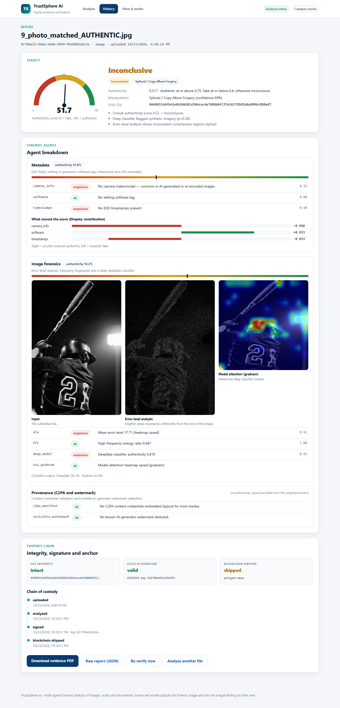
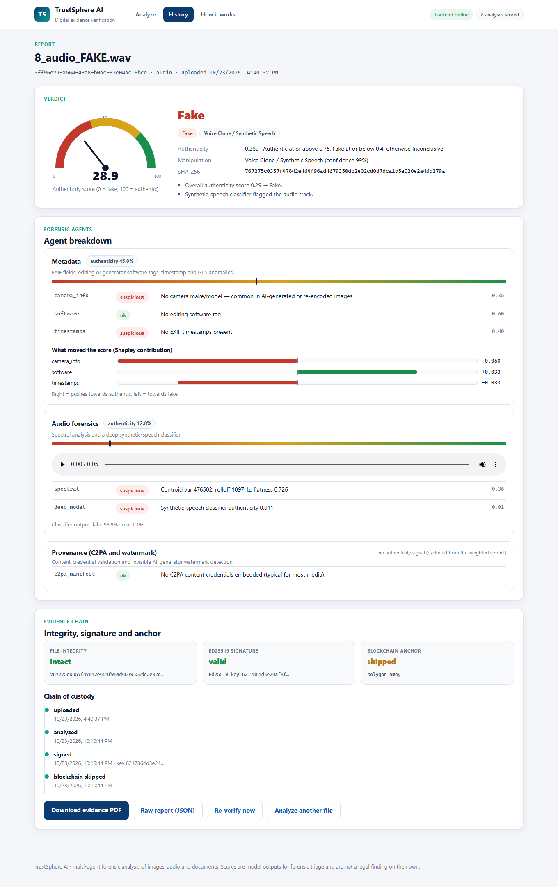
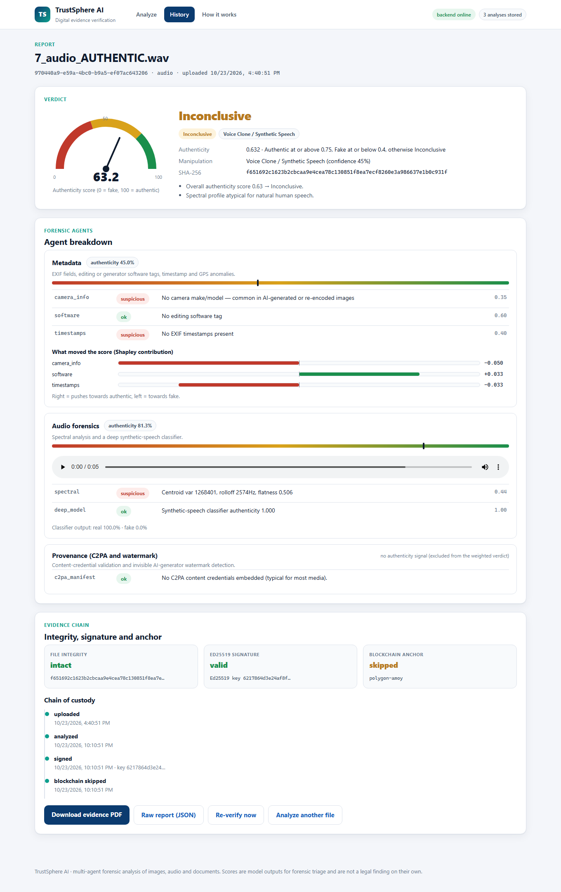
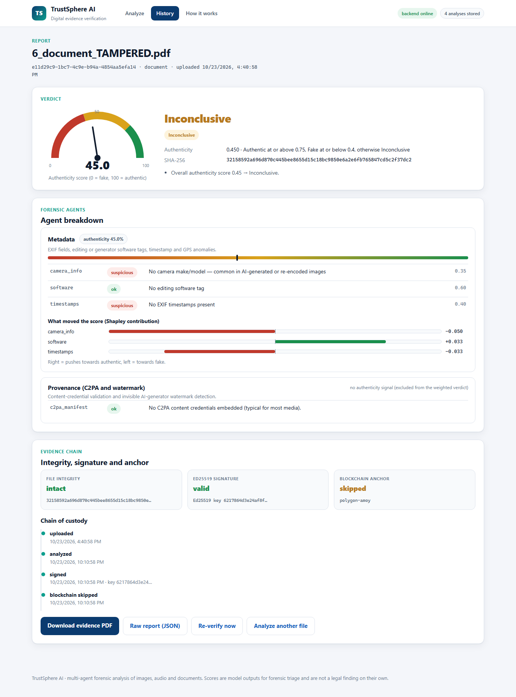
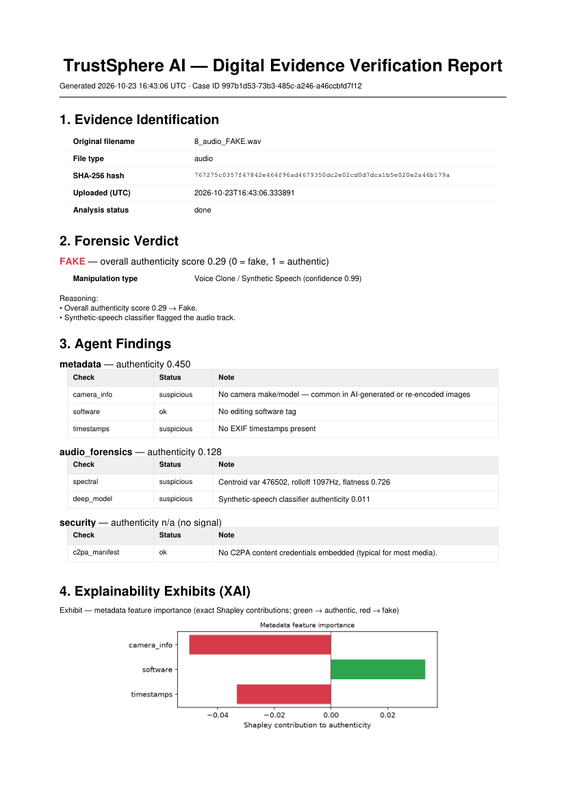
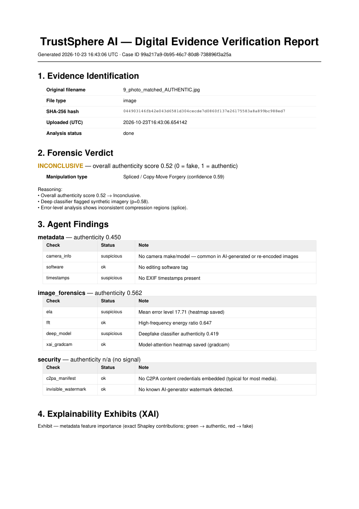

# 🔬 TrustSphere AI

**Autonomous Deepfake Detection & Digital Evidence Verification using Multi-Agent Forensic Analysis**

TrustSphere AI takes an **image, audio clip, or document** and determines whether it is authentic or AI-manipulated — and goes further than a simple fake/real score. It explains **how** it was faked (face swap, voice clone, GAN/AI-generated), estimates **which generator** likely produced it, and packages the result into a **court-admissible evidence report**: a cryptographically signed, blockchain-anchored PDF with visual explanations.

> College project (VIT). The backend pipeline is feature-complete, and a **full web app** (upload, live analysis, reports, history, evidence verification) is now served by the backend itself at `/app/`.

---

## What it does

Upload a file → multiple forensic agents independently score it → a decision engine fuses the scores into a verdict → the record is signed and anchored on-chain → an explainable legal PDF is generated.

- **Verdict:** Authentic / Fake / Inconclusive, with an overall authenticity score.
- **How it was faked:** manipulation type (GAN/AI-generated, voice clone, splice, retouch, C2PA-tamper).
- **Which AI made it:** best-guess generator attribution (watermark + frequency fingerprint).
- **Explainability:** Grad-CAM heatmaps (where the model looked) and exact Shapley attribution (which metadata fields mattered).
- **Tamper-proof evidence:** Ed25519 digital signature + a real transaction anchored on the Polygon (Amoy) blockchain.
- **Legal report:** a multi-page PDF with findings, heatmaps, chain of custody, blockchain proof, and a plain-English AI-generated summary.

### Supported file types
✅ Images &nbsp; ✅ Audio &nbsp; ✅ Documents &nbsp; — ❌ Video (removed; too heavy for this project's scope)

---

## The forensic agents

| Agent | What it checks |
|---|---|
| **Metadata** | EXIF, editing/generator software tags, timestamp & GPS anomalies |
| **Image** | Error-Level Analysis (ELA) + FFT frequency fingerprint + a deep ViT deepfake classifier |
| **Audio** | librosa spectral analysis + a Wav2Vec2-based synthetic-speech classifier |
| **Security** | C2PA content-credential validation + invisible-watermark detection (runs on every file) |

The agents run sequentially inside one Celery task; the decision engine weight-fuses their scores (image 30% · audio 20% · metadata 20% · security 25%). A valid C2PA manifest fast-tracks a file to *Authentic*.

---

## Tech stack

**Backend:** Python · FastAPI · SQLAlchemy · Celery
**Data/Queue:** Supabase PostgreSQL (session pooler) · Upstash Redis
**AI/ML:** HuggingFace Transformers (ViT + Wav2Vec2 classifiers) · OpenCV · librosa · Grad-CAM · closed-form Shapley
**Security:** Ed25519 signing (`cryptography`) · C2PA · invisible-watermark · web3.py + Solidity on **Polygon Amoy**
**Explainability & Reports:** matplotlib · reportlab (PDF) · local **Ollama** (`llama3.1:8b`) for the AI summary — free & fully offline
**Frontend (in progress):** Next.js · TailwindCSS · shadcn/ui (dark theme)

---

## Project structure

```
trustsphere-ai/
├── backend/
│   ├── main.py                 FastAPI app; wires routers
│   ├── agents/                 metadata · image · audio · security forensic agents
│   ├── core/                   celery, tasks, decision_engine, xai, pdf_report, llm_summary
│   ├── security/               Ed25519 signing · Polygon blockchain anchoring
│   ├── contracts/              TrustSphereAudit.sol
│   ├── models/                 SQLAlchemy models (evidence, agent_results, verdicts, audit_logs)
│   ├── routers/                upload · analyze · result · report · verify
│   └── requirements.txt
├── frontend/                   Next.js scaffold (the working web app is backend/static, served at /app/)
├── scripts/                    DB migrations · contract deploy · Obsidian sync
└── README.md
```

---

## Getting started

### Prerequisites
- Python 3.11+
- Node.js + npm (for the frontend)
- [Ollama](https://ollama.com) with the `llama3.1:8b` model pulled (for the AI summary)
- A Supabase project and an Upstash Redis instance (free tiers work)

### 1. Backend setup

```bash
cd backend
python -m venv venv
# Windows:
.\venv\Scripts\Activate.ps1
# macOS/Linux:
# source venv/bin/activate

pip install -r requirements.txt
```

### 2. Configure environment

Create `backend/.env` (this file is gitignored — **never commit real secrets**). Template:

```env
# Database — Supabase session pooler (URL-encode special chars in the password)
DATABASE_URL=postgresql://<user>:<password>@<host>.pooler.supabase.com:5432/postgres

# Redis — Upstash
REDIS_URL=rediss://default:<token>@<host>.upstash.io:6379

# App
SECRET_KEY=<random-secret>
UPLOAD_DIR=uploads
MAX_FILE_SIZE=104857600

# AI models (HuggingFace)
DEEPFAKE_MODEL_ID=prithivMLmods/Deep-Fake-Detector-v2-Model
AUDIO_MODEL_ID=MelodyMachine/Deepfake-audio-detection-V2
HF_HUB_DISABLE_XET=1

# Security / blockchain (Polygon Amoy testnet)
SIGNING_KEY_PATH=keys/server_signing_key.pem
POLYGON_RPC_URL=https://rpc-amoy.polygon.technology
POLYGON_CHAIN_ID=80002
POLYGON_PRIVATE_KEY=<throwaway-wallet-key-funded-with-test-POL>
TRUSTSPHERE_CONTRACT_ADDRESS=<deployed-contract-address>

# LLM summary (local Ollama)
ENABLE_LLM_SUMMARY=1
OLLAMA_URL=http://localhost:11434
OLLAMA_MODEL=llama3.1:8b
```

> The Ed25519 signing key auto-generates at `backend/keys/server_signing_key.pem` on first run. **Never delete it** — it's required to verify previously signed records.

### 3. Run

```bash
# API server
.\venv\Scripts\python.exe -m uvicorn main:app --reload --port 8000

# In a second terminal — Celery worker (Windows uses the threads pool)
.\venv\Scripts\python.exe -m celery -A core.celery_app.celery_app worker --pool=threads -l info
```

Interactive API docs (no frontend needed): **http://localhost:8000/docs**

### Web app (one command)

```bash
cd backend
python -m uvicorn main:app --port 8000        # or double-click START_APP.bat on Windows
```

Open **http://127.0.0.1:8000/app/**. Pages: **Analyze** (upload an image, audio clip, PDF or DOCX), a per-file **report**
(verdict gauge, agent breakdown with ELA and Grad-CAM heatmaps, Shapley contributions, evidence chain with live
re-verification, chain of custody, evidence PDF), **History** of past analyses, and **How it works**.

**Local mode.** With `DATABASE_URL=sqlite:///./trustsphere.db` and `CELERY_ALWAYS_EAGER=true` in `backend/.env` the app needs
no PostgreSQL, no Redis and no Celery worker. With a PostgreSQL URL and Redis it runs exactly as before (JSONB columns on
PostgreSQL, Celery worker). The default is the original configuration; local mode is opt-in through those two variables.

Sample screenshots and results: [docs/screenshots](docs/screenshots) and [docs/RESULTS.md](docs/RESULTS.md).

| | |
|---|---|
|  **Analyze** |  **File selected** |
|  **Image report**: ELA and Grad-CAM heatmaps |  **Audio report**: fake clip |
|  **Audio report**: authentic clip |  **Document report** |
|  **History** |  **How it works** |
|  **Evidence PDF** (audio) |  **Evidence PDF** (image) |

### 4. Next.js frontend (scaffold, optional)

```bash
cd frontend
npm install
npm run dev
```

---

## API overview

| Method | Endpoint | Purpose |
|---|---|---|
| `POST` | `/api/upload` | Upload a file → creates an evidence record, queues analysis |
| `POST` | `/api/analyze/{file_id}` | (Re)run the forensic pipeline |
| `GET`  | `/api/result/{task_id}` | Poll analysis result |
| `GET`  | `/api/status/{file_id}` | Evidence status |
| `GET`  | `/api/report/{file_id}` | Full JSON report |
| `GET`  | `/api/report/{file_id}/pdf` | Download the Legal Evidence PDF |
| `GET`  | `/api/verify/{file_id}` | Re-verify file hash + signature + on-chain record |
| `GET`  | `/api/evidence` | List stored analyses with their verdicts (History page) |

---

## Roadmap

| Phase | Status |
|---|---|
| 1 — Project Setup | ✅ Done |
| 2 — Backend Core | ✅ Done |
| 3 — AI Agents (×4) | ✅ Done |
| 4 — Decision Engine | ✅ Done |
| 5 — Security Layer (signing + blockchain) | ✅ Done (live on Polygon Amoy) |
| 6 — Explainability + Legal PDF | ✅ Done (Grad-CAM, Shapley, Ollama summary) |
| **7 — Frontend Dashboard** | 🔜 **Next** |
| 7.5 — OSINT Layer | ⬜ Planned |
| 7.6 — Browser Extension | ⬜ Planned |
| 8 — Integration + Testing (industrial models) | ⬜ Planned |
| 9 — Deployment | ⬜ Planned |

---

## Notes

- **No quantum components** — dropped early as infeasible; the system uses standard cryptography (Ed25519, C2PA, Polygon).
- **Manipulation-type and GAN-attribution are rule-based** for now; trained classifier heads are planned for Phase 8 alongside an industrial model upgrade.
- Only the SHA-256 hash + verdict + timestamps go **on-chain** — the media and detailed findings stay in the database.

---

*Academic project — for research and educational use.*
