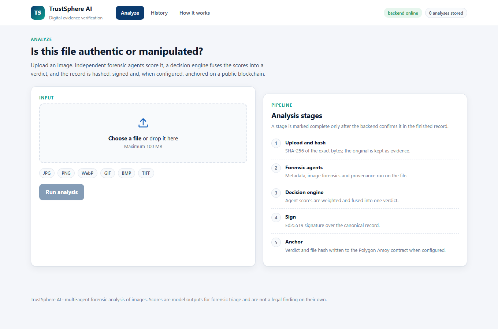
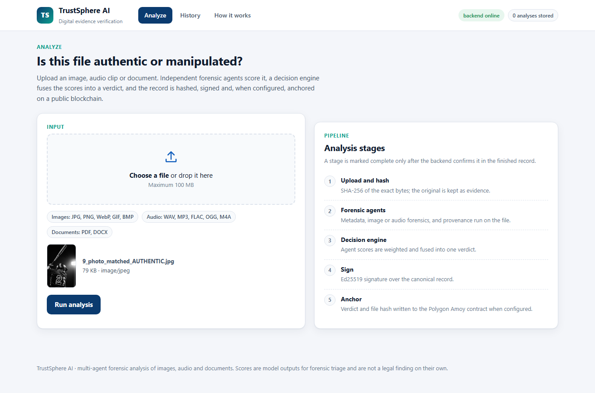
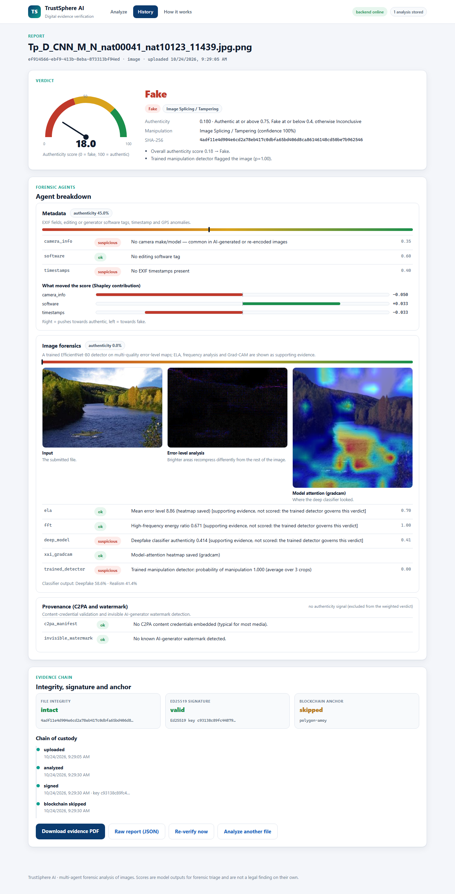
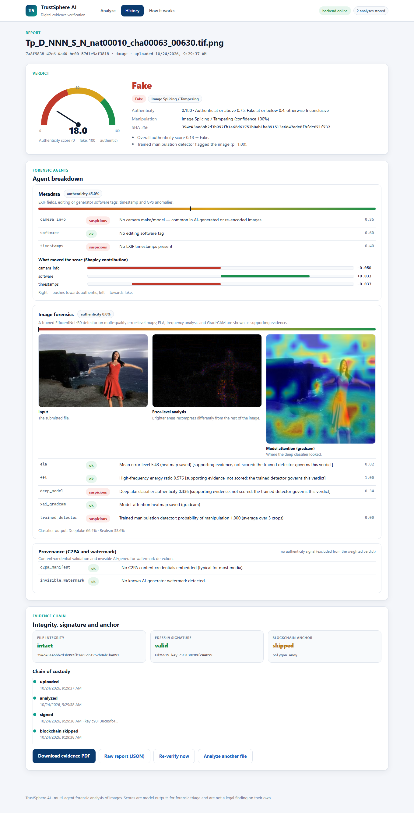
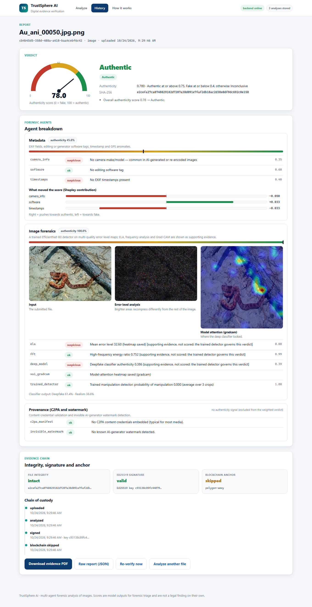
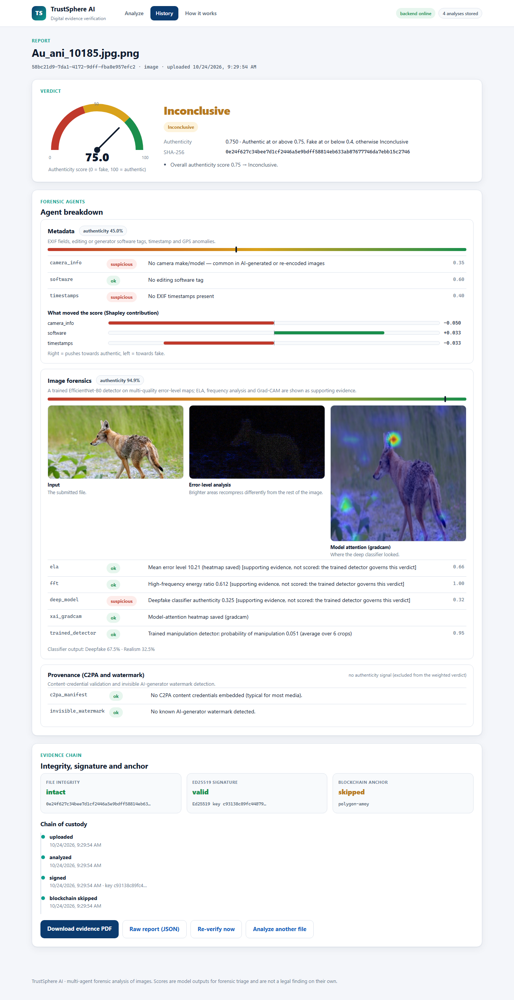
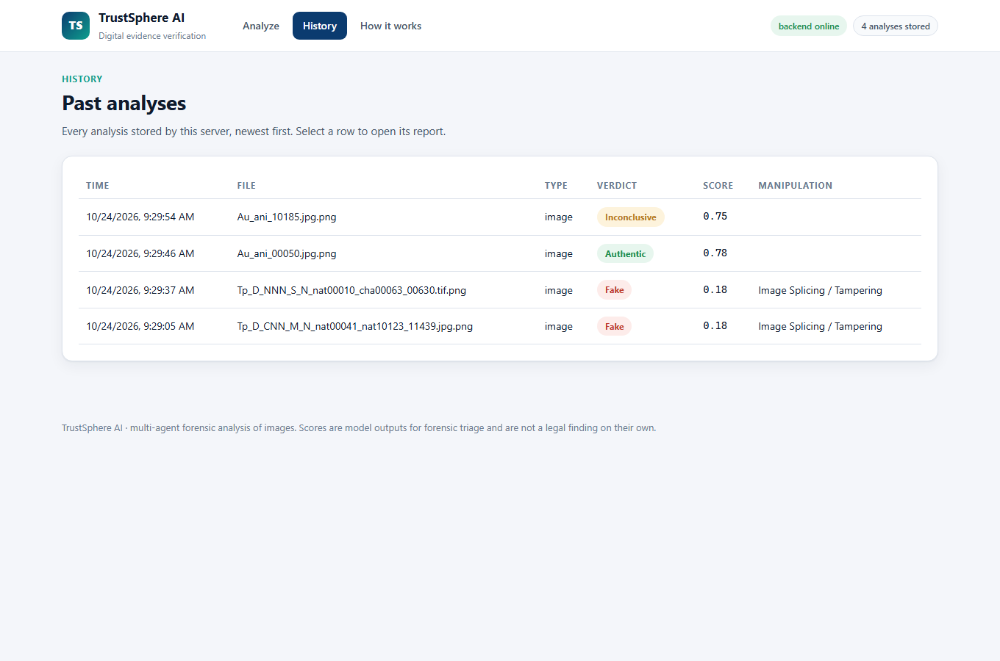
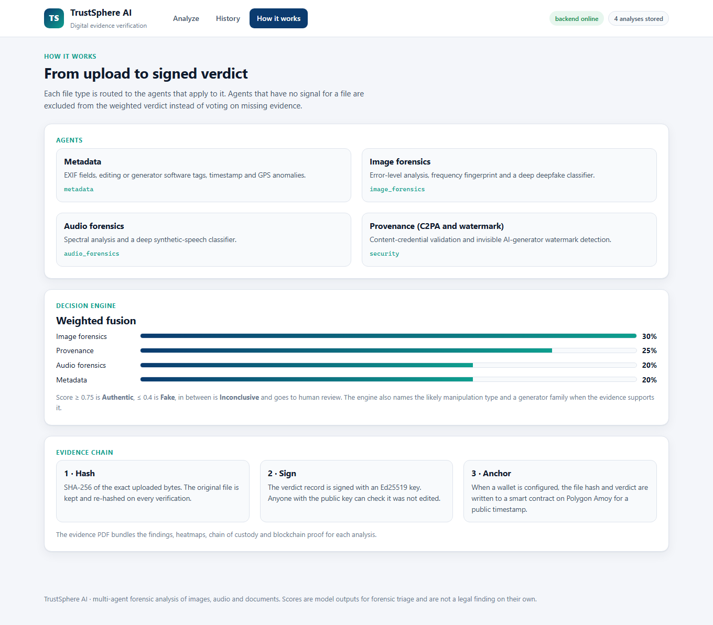
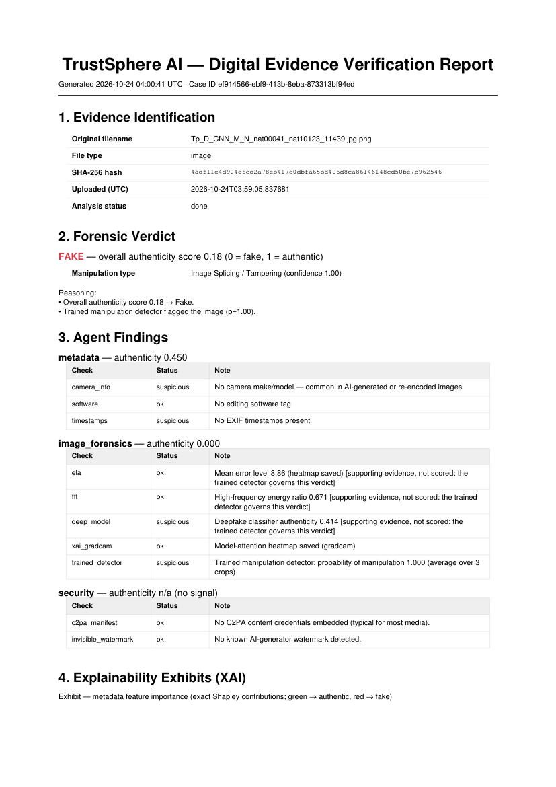
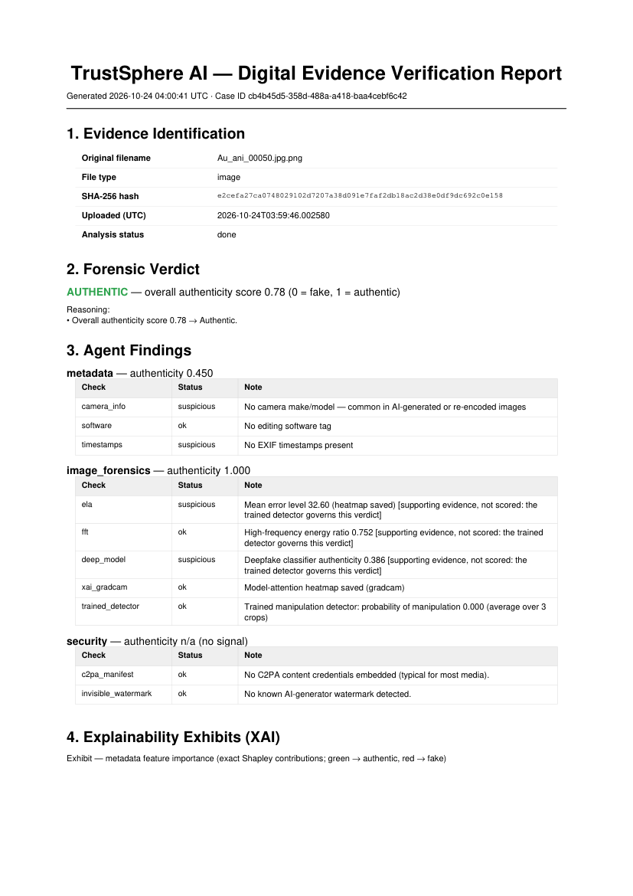

# TrustSphere AI

**Autonomous image-forgery detection and digital evidence verification using multi-agent forensic analysis**

TrustSphere AI takes an **image**, decides whether it is authentic or manipulated, explains why, and packages the
result as a tamper-evident **evidence report**: SHA-256 hash, Ed25519 signature, chain of custody, optional
Polygon Amoy anchor, and a PDF with the heatmaps.

> College project (VIT). Image-only: the earlier audio and document branches were dropped on purpose.
> A full web app (upload, live analysis, reports, history, evidence verification) is served by the backend at `/app/`.

---

## How it works

```
image ─► Metadata agent ──────┐
     ├─► Image forensics agent ├─► Decision engine ─► verdict ─► evidence record ─► PDF
     └─► Security agent ───────┘   (weighted fusion)             (hash, signature, custody, anchor)
```

| Agent | What it does | Weight |
|---|---|---|
| **Metadata** | EXIF, editing-software tags, timestamp and GPS anomalies | 0.20 |
| **Image forensics** | A **trained EfficientNet-B0 on multi-quality ELA maps** decides. ELA, FFT spectrum, Grad-CAM and a Hugging Face deepfake classifier are shown as supporting evidence | 0.30 |
| **Security / provenance** | C2PA content credentials, invisible watermark | 0.25 |

Agents that have nothing to say (confidence `None`) are left out of the fusion. Verdict bands: **Authentic** at or
above 0.75, **Fake** at or below 0.40, otherwise **Inconclusive** (sent to human review).

### The trained detector

- Input: error-level analysis at JPEG quality 70, 85 and 95 stacked as three channels, native-resolution 224 x 224 crops (up to 6 per image, logits averaged).
- Backbone: `efficientnet_b0` (timm, ImageNet-pretrained), AdamW, OneCycle, 12 epochs, mixed precision.
- Input, backbone and learning rate were chosen on a development split of CASIA v2.0 only; the reported numbers below come from out-of-fold or held-out predictions, never from that split.
- Columbia (only 363 images) is handled by a **patch-based** detector on SRM high-pass residuals (128 px patches labelled from the ground-truth masks, image score = mean of the top 5% patch probabilities).

---

## Results

Everything is produced by code in this repository; see [docs/evaluation/EVALUATION.md](docs/evaluation/EVALUATION.md) for all tables, confusion matrices, ROC curves and the comparison with the base papers.

| Experiment | Accuracy | ROC AUC | EER |
|---|---|---|---|
| CASIA v2.0, random 5-fold CV | 95.53% | 0.9917 | 4.58% |
| CASIA v2.0, source-disjoint 5-fold CV (a tampered image stays with its source) | 95.32% | 0.9933 | 4.47% |
| Columbia, patch-based, random 5-fold CV | 97.25% | 0.9872 | 2.48% |
| Columbia, patch-based, scene-disjoint 5-fold CV (30 scenes, each kept in one fold) | 96.97% | 0.9799 | 2.76% |
| Columbia, whole-image (ELA) 5-fold CV | 87.60% | 0.9610 | 11.85% |
| Full pipeline (real agents + decision engine) on 588 held-out CASIA images, forced two-way call | 96.43% | 0.9943 | 3.05% |

Full pipeline, three-way verdict on the same 588 held-out images: 90.5% of images get a decision; accuracy on decided
images 97.9%; Inconclusive counted as wrong 88.6%.

**Limits, stated plainly**

- Pixel localisation trained on CASIA and tested on Columbia reaches pixel F1 0.433, below the 0.65 that the GIFT paper reports; the localiser works on CASIA (F1 0.889) but does not transfer to Columbia's uncompressed photographs.
- Several published CASIA v2.0 results are higher than ours (96 to 99%). The comparison table in EVALUATION.md lists them.
- Columbia has only 363 images, so the fold-to-fold spread is several points. The patch-based threshold is set from the other folds' out-of-fold scores, which came from models that saw the test fold; the threshold-free AUC (0.98 scene-disjoint) is the safer figure. The deployed app uses the CASIA detector; the Columbia models are for evaluation.
- All datasets are splicing/copy-move forgery sets. AI-generated images are not what this detector was trained on; the Hugging Face classifier is supporting evidence only.

Datasets (both from the Hugging Face compilation `ductai199x/image-manipulation-dataset-compilation`): CASIA v2.0 (1,536 authentic + 1,283 tampered) and Columbia (183 authentic + 180 spliced).

---

## Screenshots

| | |
|---|---|
|  **Analyze** |  **File selected** |
|  **Tampered image: Fake** |  **Tampered image, second sample** |
|  **Authentic image: Authentic** |  **Sent to human review: Inconclusive** |
|  **History** |  **How it works** |
|  **Evidence PDF** (tampered) |  **Evidence PDF** (authentic) |

---

## Run it

### One command (Windows)

Double-click `START_APP.bat` (it uses port 8000, or the next free port if 8000 is taken, creates `backend/.env` in local mode on first run and opens the browser), or:

```bash
cd backend
python -m uvicorn main:app --port 8000
```

Open **http://127.0.0.1:8000/app/**. API docs: **http://127.0.0.1:8000/docs**.

Demonstration script, cell-by-cell explanation of every result, all approaches and which was best: [docs/DEMO_GUIDE.md](docs/DEMO_GUIDE.md).

### Results notebook (VS Code / Jupyter)

`TrustSphere_Results.ipynb` shows every result for a demonstration: accuracy table, confusion matrices, ROC and precision-recall curves,
score distributions, per-fold accuracy, the full-pipeline hold-out test, localisation, the comparison with the base papers and a live run of
the trained detector on held-out images. The outputs are saved inside the file, so it can be shown without running it.
To run it: open it in VS Code, choose a Python kernel with `numpy pandas matplotlib scikit-learn ipykernel` (the last section also needs
`torch timm pillow`) and click **Run All**. Rebuild it with `python scripts/make_notebook.py`.

### Setup

```bash
cd backend
python -m venv venv
# Windows: .\venv\Scripts\Activate.ps1     macOS/Linux: source venv/bin/activate
pip install -r requirements.txt
```

The trained weights are in `backend/models/trained/` (about 16 MB each), so no training is needed to run the app.
The Hugging Face deepfake classifier (supporting evidence) downloads on the first run.

### Configuration (`backend/.env`, never committed)

Local mode needs no PostgreSQL, Redis or Celery worker:

```env
DATABASE_URL=sqlite:///./trustsphere.db
CELERY_ALWAYS_EAGER=true
```

Full mode (PostgreSQL + Redis + Celery worker) uses `DATABASE_URL=postgresql://...`, `REDIS_URL=...` and
`python -m celery -A core.celery_app.celery_app worker --pool=threads -l info`. See `backend/.env.example` for every variable, including the
optional Polygon Amoy anchoring (`POLYGON_PRIVATE_KEY` must be a throwaway test wallet) and the local Ollama summary.

The Ed25519 signing key is generated at `backend/keys/` on first run. Do not delete it: it verifies earlier records.

### Reproduce the numbers

```bash
# 5-fold CV on CASIA v2.0 (random and source-disjoint) and Columbia
python training/train_image_detector.py --dataset casia_v2 --protocol random --input multiq --epochs 12 --lr 4e-4 --final
python training/train_image_detector.py --dataset casia_v2 --protocol group --input multiq --epochs 12 --lr 4e-4
python training/train_patch_detector.py --dataset columbia --protocol random --input srm --tag patch_srm --final
python training/train_patch_detector.py --dataset columbia --protocol group --input srm --tag patch_srm
python training/train_localizer.py

# tables, confusion matrices, ROC curves and the pipeline hold-out
python scripts/evaluate_images.py

# end-to-end test of upload -> analysis -> report -> PDF -> verification
python scripts/e2e_test.py
```

Datasets are read from the folder set in `training/common.py` (`TRUSTSPHERE_DATA` environment variable).

---

## API

| Method | Endpoint | Purpose |
|---|---|---|
| `POST` | `/api/upload` | Upload an image (JPEG, PNG, TIFF, WebP, BMP) |
| `POST` | `/api/analyze/{file_id}` | (Re)run the forensic pipeline |
| `GET` | `/api/result/{task_id}` | Poll an analysis task |
| `GET` | `/api/report/{file_id}` | Full JSON report |
| `GET` | `/api/report/{file_id}/pdf` | Evidence PDF |
| `GET` | `/api/verify/{file_id}` | Re-verify hash, signature and anchor |
| `GET` | `/api/evidence` | Stored analyses (History page) |

## Project structure

```
backend/      FastAPI app, agents, decision engine, evidence layer, web app (static/), trained weights (models/trained/)
training/     dataset indexing, detector, patch detector and localiser training
scripts/      evaluation, end-to-end test, report and diagram builders, contract deploy
docs/         evaluation (tables, figures, raw outputs), screenshots, project report (docx/pdf)
frontend/     original Next.js scaffold (the working web app is backend/static)
```

Project report (Word + PDF): [docs/report/](docs/report).

---

*Academic project, for research and educational use.*
