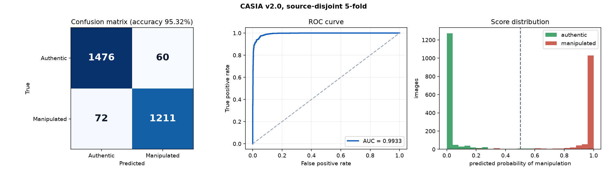
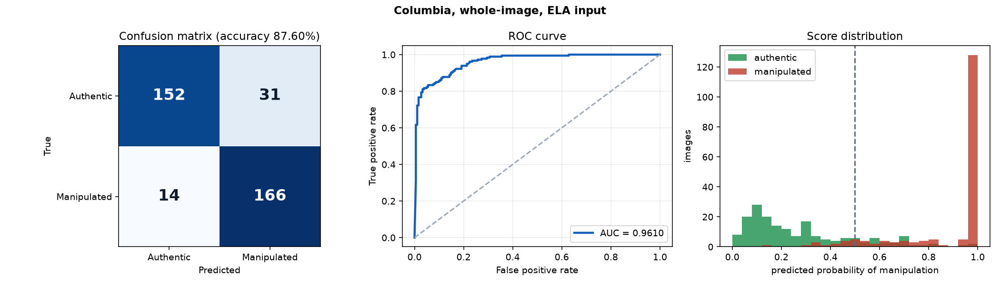
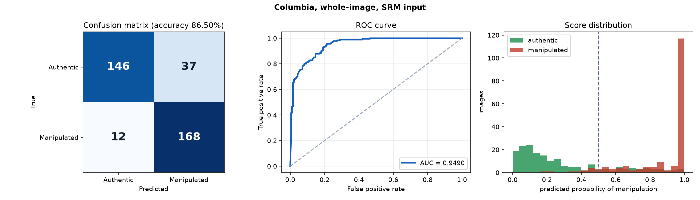
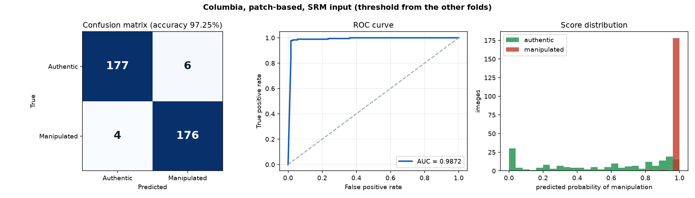
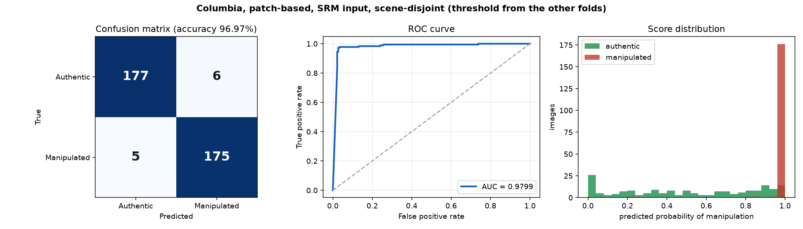
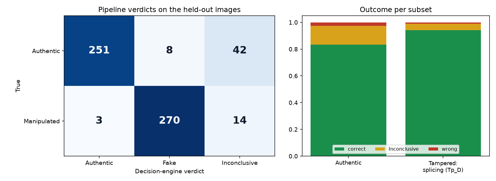
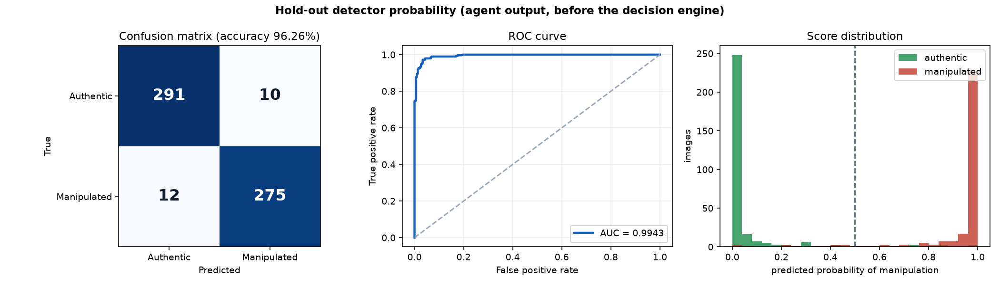
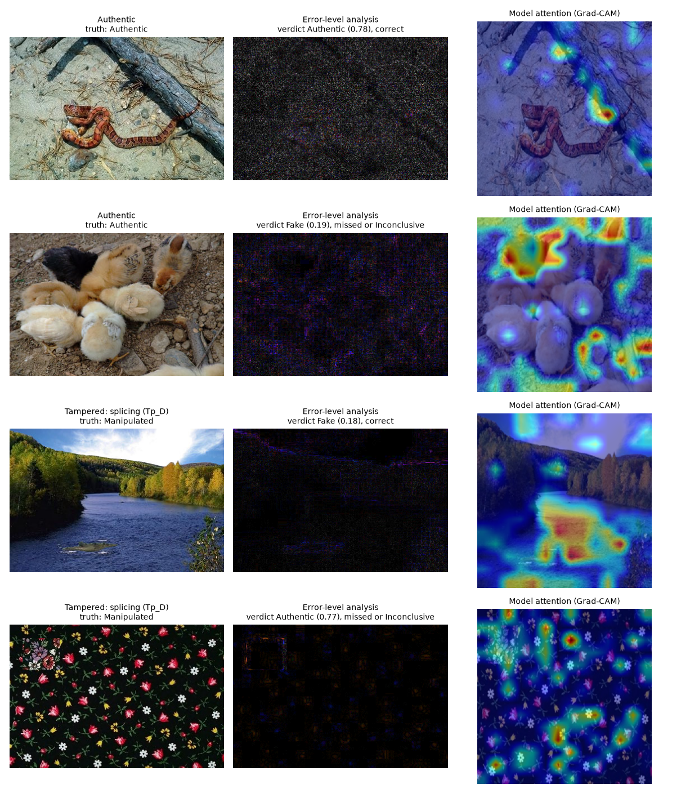

# TrustSphere AI: evaluation (image-only)

All numbers on this page are produced by code in this repository (`training/`, `scripts/evaluate_images.py`) from out-of-fold or held-out predictions; no image is scored by a model that trained on it. Datasets: CASIA v2.0 (1,536 authentic + 1,283 tampered) and Columbia (183 authentic + 180 spliced), both from the Hugging Face compilation `ductai199x/image-manipulation-dataset-compilation`. Class 1 = manipulated.

## 1. Detector accuracy by cross-validation

| experiment | input | accuracy (mean of 5 folds +- std) | pooled accuracy | ROC AUC | EER | precision | recall | F1 |
|---|---|---|---|---|---|---|---|---|
| CASIA v2.0, random 5-fold | multiq | 95.53 +- 0.86 | 95.53% | 0.9917 | 4.58% | 95.16% | 95.01% | 95.09% |
| CASIA v2.0, source-disjoint 5-fold | multiq | 95.32 +- 0.80 | 95.32% | 0.9933 | 4.47% | 95.28% | 94.39% | 94.83% |
| Columbia, whole-image, ELA input | multiq | 87.60 +- 4.27 | 87.60% | 0.9610 | 11.85% | 84.26% | 92.22% | 88.06% |
| Columbia, whole-image, SRM input | srm | 86.49 +- 5.12 | 86.50% | 0.9490 | 14.88% | 81.95% | 93.33% | 87.27% |
| Columbia, patch-based, SRM input | srm (patches) | 97.25 +- 2.12 | 97.25% | 0.9872 | 2.48% | 96.70% | 97.78% | 97.24% |
| Columbia, patch-based, SRM input, scene-disjoint | srm (patches) | 96.92 +- 2.43 | 96.97% | 0.9799 | 2.76% | 96.69% | 97.22% | 96.95% |

Fold accuracies: CASIA v2.0, random 5-fold: 95.9, 95.4, 96.8, 94.2, 95.4; CASIA v2.0, source-disjoint 5-fold: 94.0, 96.3, 95.4, 95.9, 95.0; Columbia, whole-image, ELA input: 95.9, 84.9, 84.9, 84.7, 87.5; Columbia, whole-image, SRM input: 95.9, 82.2, 84.9, 87.5, 81.9; Columbia, patch-based, SRM input: 97.3, 93.2, 98.6, 98.6, 98.6; Columbia, patch-based, SRM input, scene-disjoint: 93.0, 100.0, 97.4, 95.7, 98.6.

### CASIA v2.0, random 5-fold

### CASIA v2.0, source-disjoint 5-fold

### Columbia, whole-image, ELA input

### Columbia, whole-image, SRM input

### Columbia, patch-based, SRM input

### Columbia, patch-based, SRM input, scene-disjoint

### pipeline

## 2. The full pipeline on held-out images

588 CASIA v2.0 images (301 authentic, 287 tampered) that the detector never saw (80/20 split that keeps every tampered image with its source image). The real agents (metadata, image forensics with the trained detector, provenance) and the decision engine run on each file.

| | Authentic | Fake | Inconclusive |
|---|---|---|---|
| **True authentic** | 251 | 8 | 42 |
| **True tampered** | 3 | 270 | 14 |

* Verdict bands: Authentic at or above 0.75, Fake at or below 0.4, otherwise Inconclusive.
* Decided by the engine: 90.48%; accuracy on decided files 97.93%; strict accuracy (Inconclusive counted wrong) 88.61%.
* Forced two-way call from the engine score (below 0.5 = Fake): accuracy 96.43%, ROC AUC 0.9943, EER 3.05%.
* Detector probability alone: accuracy 96.26%, ROC AUC 0.9943.
* Authentic images called Fake: 2.66%; tampered images called Authentic: 1.05%.

| subset | n | correct verdict | Inconclusive | wrong verdict |
|---|---|---|---|---|
| Authentic | 301 | 83.39% | 13.95% | 2.66% |
| Tampered: splicing (Tp_D) | 287 | 94.08% | 4.88% | 1.05% |

### Sample outputs

Raw agent and decision output for these samples is in [samples/](samples/).

## 3. Pixel-level localisation (GIFT protocol)

A U-Net-style network (EfficientNet-B0 encoder on RGB plus multi-quality ELA) trained on CASIA v2.0 only and tested on Columbia, which it never saw (threshold 0.35 chosen on CASIA validation).

| set | pooled pixel F1 | mean per-image pixel F1 | pixel AUC | image AUC from the map |
|---|---|---|---|---|
| CASIA v2.0 validation (held out, source-disjoint) | 0.8889 | 0.7554 | 0.9569 | 0.9868 |
| Columbia (cross-dataset, never used in training) | 0.4330 | 0.3885 | 0.6743 | 0.7994 |

GIFT (Chen et al. 2026) reports pixel F1 0.6497 (0.6558 with edge supervision) on Columbia under the same train-on-CASIA protocol. **Our localiser is clearly below that on Columbia**: it localises well on CASIA validation images but does not transfer to Columbia's uncompressed photographs.

## 4. Comparison with the five base papers

Each row compares like with like (same dataset, same kind of metric). Protocols still differ (their splits, subsets and training data), so treat this as context, not a leaderboard.

| base paper | dataset | metric | reported | TrustSphere | result |
|---|---|---|---|---|---|
| SD31 Ravula et al. 2025 (GAN-ViT-CMFD) | CASIA v2.0 | accuracy | 94.4% | 95.53% random / 95.32% source-disjoint | above |
| SD35 Rehman et al. 2025 (CNN + SVM) | CASIA v2.0 | accuracy | 93.57% (mean over runs 93.39%; best run 98.91%) | 95.53% / 95.32% | above the 93.57% run and the mean; below the 98.91% best run |
| SD52 Deb et al. 2026 (Satyachitra) | CASIA v2.0 | precision / recall / F1 | 87.31 / 90.15 / 88.33 | 95.16% / 95.01% / 95.09% | above |
| SD25 Ranjan et al. 2026 (LOOP + ResNet-50 + SVM) | Columbia, CASIA v2.0, Dresden pooled | accuracy | 95.20% | CASIA alone 95.53% (Dresden not used here) | level on CASIA; see the pooled row |
| SD25 table of earlier Columbia methods | Columbia | accuracy | 91 to 93.4% | 97.25% random / 96.97% scene-disjoint (patch-based) | above |
| SD25 Ranjan et al. 2026 (pooled average, Dresden included there) | CASIA v2.0 + Columbia pooled | accuracy | 95.20% | 95.73% random / 95.51% source- and scene-disjoint | see text |
| GIFT Chen et al. 2026 | Columbia (trained on CASIA v2.0) | pixel F1 | 0.6497 / 0.6558 | 0.4330 | below |

### Other CASIA v2.0 results found outside the reference folder (not verified against the papers)

| source | reported on CASIA v2.0 |
|---|---|
| Depth-wise CNN (MobileNet-based), IIETA | 99.37% accuracy |
| ELA + CNN (PMC study) | 94.14% and 96.21% |
| ELA + HOG with SVM (2025) | 95.50% |
| EfficientNet-B0 image fake-news study | 96.11% |
| ELA + MobileNetV2 (2025) | 93.1% |
| CNN on 9,319 CASIA v2.0 images | 92.5% |

These include papers above our accuracy. They are listed here for completeness.

